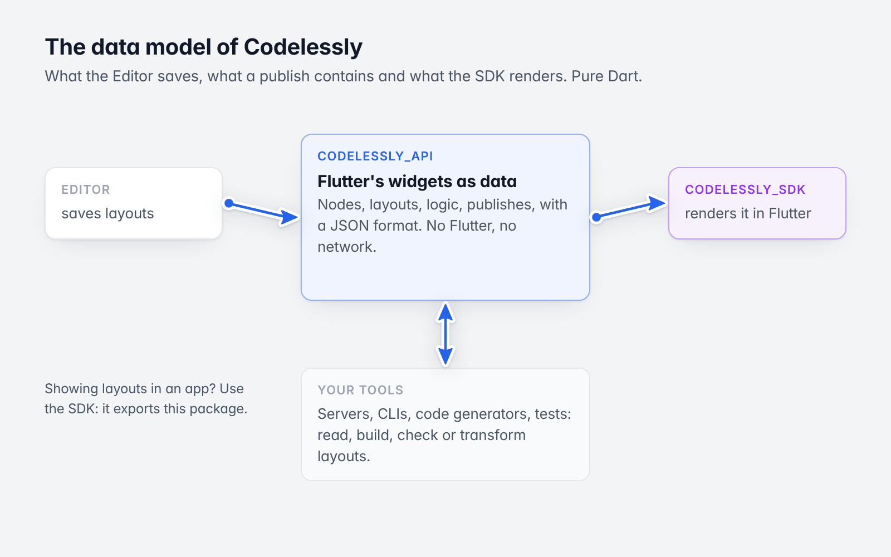

# Codelessly API

Flutter's widgets and layouts as plain, immutable data, with a JSON format. This is the model behind the
[Codelessly Editor](https://codelessly.com) and the [Codelessly SDK](https://pub.dev/packages/codelessly_sdk):
nodes, layouts, variables, conditions, actions, scripts, breakpoints and published apps.



*The model, between the Editor and the SDK.*

Pure Dart: no Flutter, no network, two small dependencies (`collection`, `meta`).

> **Looking to show Codelessly screens in a Flutter app?** Use
> [`codelessly_sdk`](https://pub.dev/packages/codelessly_sdk). It exports this package. Use `codelessly_api` on its
> own to read, build, check or transform layouts without Flutter: servers, CLIs, code generators, tests.

```dart
import 'package:codelessly_api/codelessly_api.dart';
```

## Install

```sh
dart pub add codelessly_api
```

Dart 3.12 or newer.

## A layout in 30 lines

```dart
import 'dart:convert';

import 'package:codelessly_api/codelessly_api.dart';

void main() {
  final document = LayoutDocument.fromJson({
    'schema': 2,
    'id': 'hello',
    'roots': ['home'],
    'nodes': {
      'home': {
        'type': 'canvas',
        'name': 'Home',
        'slots': {'body': 'column'},
        'layout': {'width': 390, 'height': 844},
      },
      'column': {
        'type': 'column',
        'children': ['title'],
        'layout': {'width': {'fill': 390}, 'height': {'fill': 844}, 'padding': 24},
        'props': {'spacing': 12, 'crossAxisAlignment': 'start'},
      },
      'title': {
        'type': 'text',
        'props': {'text': 'Hello!', 'style': {'fontSize': 24, 'fontWeight': 700}},
      },
    },
  });

  // Typed access, with Flutter's names and defaults.
  final column = document['column']!;
  print(column.prop(FlexProps.spacing)); // 12.0
  print(column.prop(FlexProps.mainAxisAlignment)); // MainAxisAlignment.start (Flutter's default)

  // Immutable: an edit is a copy. Value equality tells what changed.
  final edited = document['title']!.withProp(TextProps.text, 'Hello, world!');
  print(edited == document['title']); // false

  // Sparse JSON out: defaults aren't written.
  print(jsonEncode(edited.toJson()));
}
```

## What is in the model

| | |
|---|---|
| **Nodes** | `Node`: a widget `type`, its `Layout`, `Decoration`, typed `Props`, bindings, reactions and behaviors. Immutable, with value equality. |
| **Widgets** | `WidgetSpec`: one declaration per widget type (66 of them), with each prop's Flutter name, type and default. `Widgets.all`, `Widgets.of(type)`. |
| **Documents** | `LayoutDocument`: canvases (screens) and every node in one flat map; parents are derived, never stored. |
| **Logic** | `Variable`, `Condition`, `Reaction` / `Trigger` / `ActionDef` (one class per action), `ScriptDef`, binding paths. |
| **Publish** | `PublishModel`, `PublishLayout`, `PublishBundle`, `Breakpoints`, `ThemeTokens`, `AppIdentity`, `HttpApi`. |
| **Values** | `Color`, `EdgeInsets`, `BorderRadius`, `Alignment`, `BoxConstraints`, `TextStyle`, `Paint`... with Flutter's names. |

## The JSON contract

- **Total decoding.** `fromJson` never throws. Unknown keys and unknown node types round-trip; a bad value falls
  back to its default.
- **Sparse encoding.** A value equal to Flutter's default is not written.

## Guide

- [The data model](https://github.com/Codelessly/CodelesslyAPI/blob/master/docs/guide/01-data-model.md)
- [Widgets and `WidgetSpec`](https://github.com/Codelessly/CodelesslyAPI/blob/master/docs/guide/02-widgets-and-widgetspec.md)
- [The JSON format](https://github.com/Codelessly/CodelesslyAPI/blob/master/docs/guide/03-json-format.md)
- [Building and checking a layout in code](https://github.com/Codelessly/CodelesslyAPI/blob/master/docs/guide/04-building-layouts-in-code.md)
- [Logic: variables, conditions, actions, scripts](https://github.com/Codelessly/CodelesslyAPI/blob/master/docs/guide/05-logic.md)

The [example](https://github.com/Codelessly/CodelesslyAPI/tree/master/example) builds a layout with the typed
classes, round-trips it through JSON and wraps it as a publish bundle.

## Using it with Flutter

Several value types share Flutter's names (`Color`, `EdgeInsets`, `TextStyle`, `Alignment`...). In a Flutter file,
import this package with a prefix:

```dart
import 'package:codelessly_api/codelessly_api.dart' as api;
```

`codelessly_sdk` re-exports the model without those types for that reason.

## License

BSD 3-Clause. See [LICENSE](https://github.com/Codelessly/CodelesslyAPI/blob/master/LICENSE).
