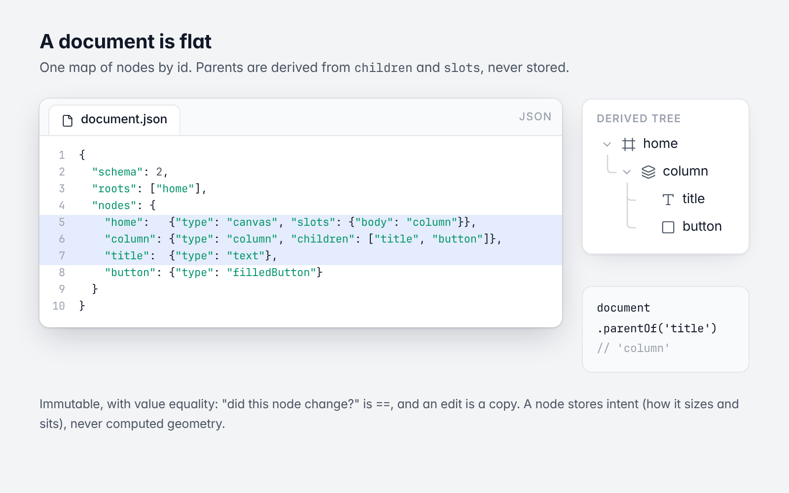
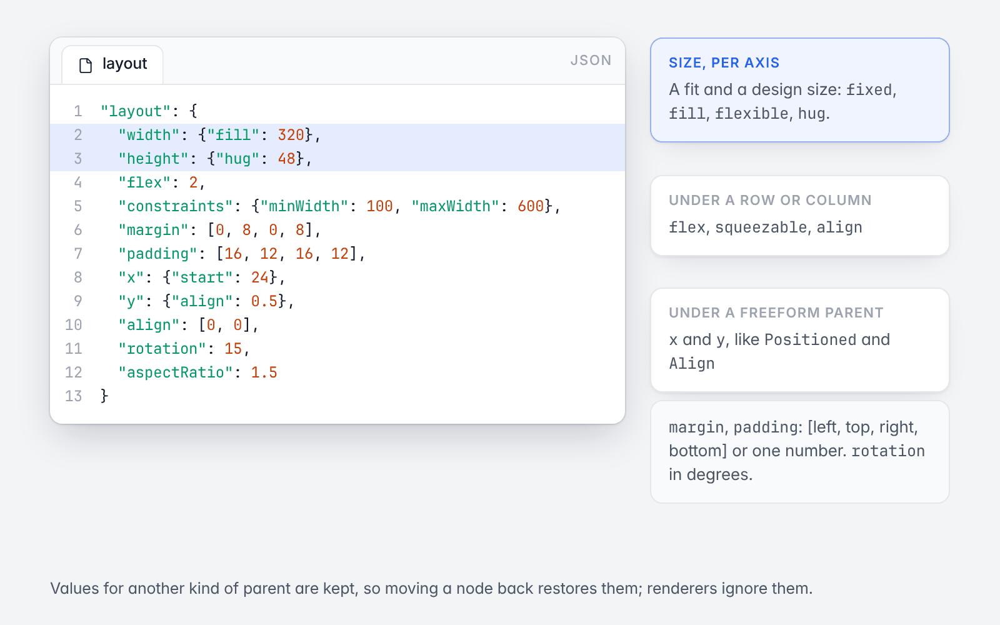
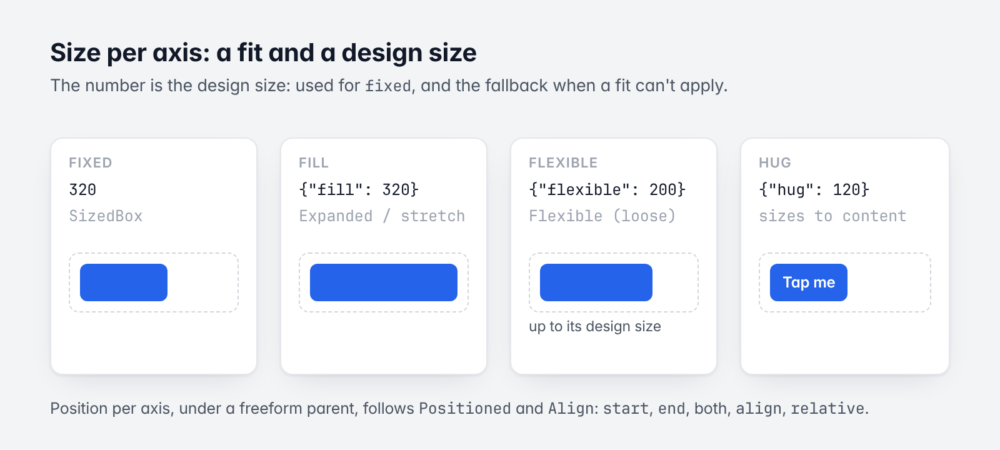

# 1. The data model

[Guide](README.md) · Next: [Widgets and `WidgetSpec`](02-widgets-and-widgetspec.md)



*A document is one flat map; the tree is derived.*

## Principles

- **Flutter's vocabulary.** A node is a Flutter widget's parameters as data: Flutter's names, types and defaults
  (`mainAxisAlignment` defaults to `start`, as in Flutter).
- **Intent, not results.** A node stores how it wants to be sized and placed, never computed geometry.
- **Immutable, with value equality.** "Did this node change?" is `==`. An edit is a copy.
- **Flat.** A document is one map of nodes by id. Parents are derived from `children` and `slots`, never stored.
- **Pure Dart.** No Flutter imports, no network code, no globals.

## Node

`Node` is one widget.

| Field | Type | Meaning |
|---|---|---|
| `id` | `String` | Unique in its document. |
| `type` | `String` | The widget type: `row`, `text`, `filledButton`... A key of `Widgets`. |
| `name` | `String` | Display name. |
| `key` | `String` | The node's name within the tree it was inserted with; a stable handle for tools. Doesn't affect rendering. |
| `children` | `List<String>` | Ordered child ids (row, column, stack, list...). |
| `slots` | `Map<String, String>` | Named children: `body`, `appBar`, `leading`... |
| `visible` | `bool` | `false` hides the node, and it takes no space. Default `true`. |
| `opacity` | `double` | 0 to 1. Default 1. |
| `layout` | `Layout` | How it sizes itself and sits in its parent. |
| `decoration` | `Decoration` | Fills, strokes, radius, shadows, blurs, clip. |
| `props` | `Props` | The widget's own parameters, by its `WidgetSpec`. |
| `bind` | `Map<String, String>` | Bound properties: binding path → expression ([Logic](05-logic.md#bindings)). |
| `actions` | `List<Reaction>` | Trigger → chain of actions ([Logic](05-logic.md#reactions-and-actions)). |
| `behaviors` | `Behaviors` | Motion, loops, transitions, ink, interaction states, drag and drop, hero... Stored flat in the node's JSON. |
| `component` | `ComponentLink?` | The component this node is the main node or an instance of. |
| `extra` | `Json` | Keys this version doesn't model, round-tripped. |

```dart
final node = Node.fromJson({
  'type': 'column',
  'props': {'spacing': 12, 'crossAxisAlignment': 'start'},
}, id: 'col')!;

final double spacing = node.prop(FlexProps.spacing); // 12.0
final CrossAxisAlignment cross = node.prop(FlexProps.crossAxisAlignment); // start
final MainAxisAlignment main = node.prop(FlexProps.mainAxisAlignment); // Flutter's default: start
```

Useful members: `prop(def)`, `withProp(def, value)`, `copyWith(...)`, `patched(jsonMergePatch)`, `childIds`
(slots, then children), `spec` (its `WidgetSpec`, or null for a type this version doesn't know), `toJson()`.

## Layout



*Layout fields, grouped by what reads them.*

`Layout` is how a node sizes itself and where it sits in its parent, in Flutter's terms.

```json
"layout": {
  "width": {"fill": 320},
  "height": {"hug": 48},
  "flex": 2,
  "constraints": {"minWidth": 100, "maxWidth": 600},
  "margin": [0, 8, 0, 8],
  "padding": [16, 12, 16, 12],
  "x": {"start": 24},
  "y": {"align": 0.5},
  "align": [0, 0],
  "aspectRatio": 1.5
}
```

**Size per axis** (`AxisSize`): a fit and a design size.

| Fit | JSON | Flutter |
|---|---|---|
| `fixed` | `320` | `SizedBox` |
| `fill` | `{"fill": 320}` | `Expanded` on a main axis; stretch on a cross axis or in a stack |
| `flexible` | `{"flexible": 200}` | `Flexible` (loose): up to its design size |
| `hug` | `{"hug": 120}` | Sizes to its content |

The number is the design size: the size used for `fixed`, and the fallback when a fit can't apply.



*The four size fits.*

**Position per axis** (`AxisPosition`), under a freeform parent (a stack), follows `Positioned` and `Align`:

| JSON | Meaning |
|---|---|
| `{"start": d}` | `d` from the start edge |
| `{"end": d}` | `d` from the end edge |
| `{"start": a, "end": b}` | Stretched between |
| `{"align": -1..1}` | Aligned by the laid-out size |
| `{"relative": d}` | `d` from the start at design size, keeping its share of the free space as the parent resizes |

`flex`, `squeezable` and `align` apply under a row or column; `x` and `y` under a freeform parent. Values for
another kind of parent are kept, so moving a node back restores them, and renderers ignore them.

`margin` and `padding` are `[left, top, right, bottom]`, or a single number for all four sides.
A turn or a scale is not layout (neighbours don't move): it is the node's `motion`, Flutter's `Transform`
(`"motion": {"rotate": 15}`, chapter 8). Schema 3's `layout.rotation` and node `scale` are migrated there.

## Decoration

`Decoration` is a box's paint: Flutter's `BoxDecoration`, with stacked paints as in a design tool.

| Field | Meaning |
|---|---|
| `fills`, `foregroundFills` | `List<Paint>`, bottom to top: solid colors, gradients, images |
| `strokes`, `strokeWidth`, `strokeAlign`, `strokeSides`, `strokeCap`, `dashPattern` | Borders |
| `radius` | `BorderRadius`: `8`, `[16, 8]` (elliptical), or `[tl, tr, br, bl]` |
| `effects` | Shadows and blurs |
| `clip`, `blendMode` | |

Colors are `#AARRGGBB` in JSON and `Color(0xAARRGGBB)` in Dart.

## Props

`Props` holds a widget's own parameter values. Only values that differ from Flutter's defaults are held. They are
read and written through `PropDef`s, which carry the type:

```dart
node.prop(TextProps.text);                    // String
node.withProp(FlexProps.spacing, 12);         // stores 12.0: checked against the declaration
node.props.unknown;                           // keys the declaration doesn't know, kept
```

[Widgets and `WidgetSpec`](02-widgets-and-widgetspec.md) lists the declarations.

## Document

`LayoutDocument` is a layout: its canvases (`roots`, in order) and every node in one flat map.

```dart
document['column'];            // a node by id
document.parentOf('title');    // 'column' (derived)
document.subtree('home');      // 'home' and its descendants, depth first
document.copyWith(nodes: {...document.nodes, 'title': edited});
```

Keys of a document's JSON that aren't `schema`, `id`, `roots` or `nodes` are kept in `extra`. That is where a
document's variables, conditions, scripts and breakpoints live; typed views read them:
`document.logic`, `document.scripts` ([Logic](05-logic.md)).

A **canvas** is a node of type `canvas`: a screen (`Scaffold`). Its content is its `body` slot. A layout has one
canvas, or one per breakpoint.

## Components

A node can be the main node of a **component**, or the top node of an instance of one (`Node.component`, a
`ComponentLink` with the component's id, version and the instance's settings). A stored component is a
`ComponentDefinition`: a small document of its own with a size and a preview.

## Values

Value types mirror Flutter's and keep its names: `Color`, `EdgeInsets`, `BorderRadius`, `Alignment`, `Offset`,
`BoxConstraints`, `TextStyle`, `Paint`, `BorderSide`, and enums with Flutter's value names
(`MainAxisAlignment.spaceBetween`). They are this package's own classes, since it doesn't import Flutter. In a
Flutter file, import the package with a prefix to avoid the name clashes:

```dart
import 'package:codelessly_api/codelessly_api.dart' as api;
```

Next: [Widgets and `WidgetSpec`](02-widgets-and-widgetspec.md)
