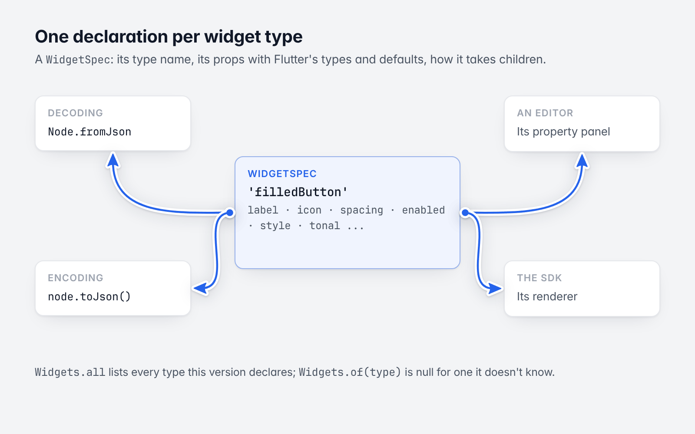
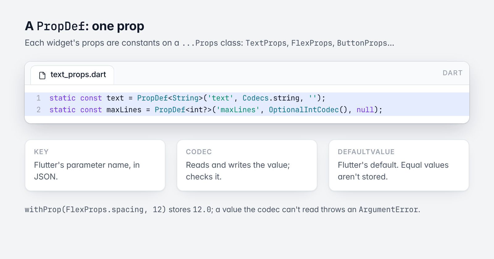

# 2. Widgets and `WidgetSpec`

[Guide](README.md) · Previous: [The data model](01-data-model.md) · Next: [The JSON format](03-json-format.md)

Each widget type has **one declaration**, a `WidgetSpec`: its type name, its props with Flutter's types and
defaults, and how it takes children. Decoding, encoding, an editor's property panel and the SDK's renderer all
read that one declaration.



*One declaration, read by everything.*

## `WidgetSpec`

| Field | Meaning |
|---|---|
| `type` | The node `type` string. |
| `props` | Its `PropDef`s. |
| `children` | `ChildModel.none` (a leaf), `list` (ordered `children`) or `slots` (named `slots` only). |
| `slots` | The named slots it takes: `body`, `leading`... |
| `decorated` | Whether it has a box decoration (fills, strokes, radius, effects). |
| `childFields` | What it reads from each child's layout to place it: Flutter's parent data (`flex` and `align` for a row). |
| `childFits` | Which size fits a child may take. |
| `doc` | The Flutter widget it stands for. |

## `PropDef`



*A PropDef: key, codec, default.*

A `PropDef<T>` is one prop: its JSON `key` (Flutter's parameter name), a codec, and `defaultValue` (Flutter's
default; values equal to it aren't stored).

```dart
abstract final class TextProps {
  static const text = PropDef<String>('text', Codecs.string, '');
  static const maxLines = PropDef<int?>('maxLines', OptionalIntCodec(), null);
  static const overflow = PropDef<TextOverflow>('overflow', EnumCodec(TextOverflow.values), TextOverflow.clip);
  // ...
  static const spec = WidgetSpec('text', props: [text, style, runs, textAlign, /* ... */], doc: 'Flutter `Text.rich`.');
}
```

Each widget's props are constants on a `...Props` class: `TextProps`, `FlexProps`, `StackProps`, `BoxProps`,
`CanvasProps`, `ButtonProps`, `IconProps`, and so on. Use them to read and write:

```dart
node.prop(TextProps.maxLines);                         // int?
node.withProp(TextProps.overflow, TextOverflow.ellipsis);
```

A value is checked against the declaration, not the call site: `withProp(FlexProps.spacing, 12)` stores `12.0`,
and a value the codec can't read throws an `ArgumentError`.

## Finding declarations

```dart
// Every widget type this version declares.
print('${Widgets.all.length} widget types: ${Widgets.all.take(8).map((s) => s.type).join(', ')}, ...');

// One declaration: its props, with Flutter's types and defaults.
final spec = Widgets.of('filledButton')!;
for (final prop in spec.props) {
  print('  ${spec.type}.${prop.key}: ${prop.type.typeName}${prop.nullable ? '?' : ''} = ${prop.defaultValue}');
}
```

```
66 widget types: canvas, stack, box, row, column, text, icon, spacer, ...
  filledButton.label: String =
  filledButton.textAlign: TextAlign = TextAlign.start
  filledButton.icon: IconData = {}
  filledButton.iconAlignment: IconAlignment = IconAlignment.start
  filledButton.spacing: double = 8.0
  filledButton.enabled: bool = true
  filledButton.style: ButtonStyle = Instance of 'ButtonStyle'
  filledButton.tonal: bool = false
```

`Widgets.of(type)` is null for a type this version doesn't know. Such a node still decodes and round-trips
([The JSON format](03-json-format.md#total-decoding)).

## The widget types

| Group | Types |
|---|---|
| Structure | `canvas`, `stack`, `box`, `row`, `column`, `spacer`, `variance`, `placeholder`, `singlePlaceholder` |
| Text and icons | `text`, `icon` |
| Collections | `listView`, `gridView`, `pageView`, `tabs`, `tabBar`, `accordion`, `expansionTile`, `pagination`, `tableView` |
| Inputs | `textField`, `checkbox`, `switch`, `radio`, `slider`, `dropdown`, `datePicker`, `timePicker`, `dateTimeInput`, `segmentedButton`, `signature` |
| Material | `elevatedButton`, `filledButton`, `textButton`, `outlinedButton`, `iconButton`, `floatingActionButton`, `chip`, `actionChip`, `choiceChip`, `filterChip`, `inputChip`, `badge`, `listTile`, `appBar`, `navigationBar`, `bottomNavigationBar`, `divider`, `verticalDivider`, `modal` |
| Indicators and charts | `circularProgressIndicator`, `activityIndicator`, `progressBar`, `radialGauge`, `gaugeMeter`, `chart`, `plotChart`, `barChart`, `lineChart`, `barcode` |
| Media | `path`, `video`, `embeddedVideo`, `audioPlayer`, `webView`, `external` |

`Widgets.all` is the authoritative list; print it for the version you have.

A `listView` with `"stickToEnd": true` opens at its end, keeps the items on screen in place when items are put
before them, and follows items added at the end only while scrolled there: a chat or a log, with its data in
reading order (oldest first).

## Prop types, for tools

`PropDef.type` is a `PropType`: pure data describing what a prop holds, so a tool can build a control, print
documentation or generate code without knowing the widget.

| `PropKind` | Example | Extra |
|---|---|---|
| `boolean`, `integer`, `number`, `string` | `enabled`, `maxLines`, `spacing`, `label` | `min`, `max` for numbers |
| `enumeration` | `MainAxisAlignment` | `values`: the value names |
| `value` | `Color`, `EdgeInsets`, `BorderRadius`, `Alignment`, `Offset`, `BoxConstraints`, `IconData` | Edited as a whole |
| `list` | `List<Paint>` | `item`: the element's type |
| `object` | `TextStyle`, `ButtonStyle`, `Paint` | `fields`: its own `PropDef`s |
| `json` | Data rows, opaque configuration | |

```dart
final align = FlexProps.mainAxisAlignment.type;
assert(align.kind == PropKind.enumeration && align.values.contains('spaceBetween'));
assert(Widgets.of('column')!.children == ChildModel.list);
assert(Widgets.of('canvas')!.slots.contains('body'));
```

`PropType.typeName` is the Flutter type's name (`double`, `Color`, `List<Paint>`). A prop is nullable when its
default is null (`PropDef.nullable`).

Layout fields are declared the same way (`LayoutFields.width`, `.padding`, `.flex`...), as are structured models
such as `Breakpoint`, so one generic panel or generator covers them all.

## Adding a widget type

Widget types are added in this package (a `...Props` class with its `spec`, listed in `Widgets.all`) and rendered
in the SDK (a recipe per type; see the SDK's `PORTING.md`). There is no runtime registry for third-party
types. For app-specific widgets inside a layout, use the `external` type, which the SDK fills with a widget of
the app's.

Next: [The JSON format](03-json-format.md)
