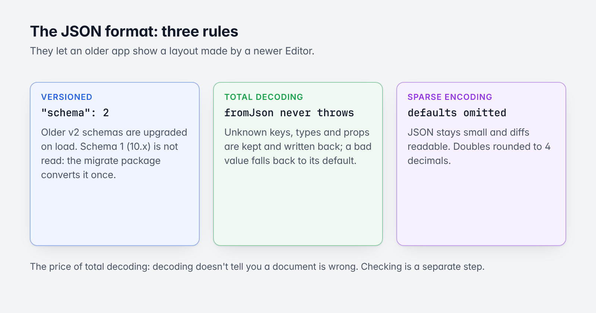
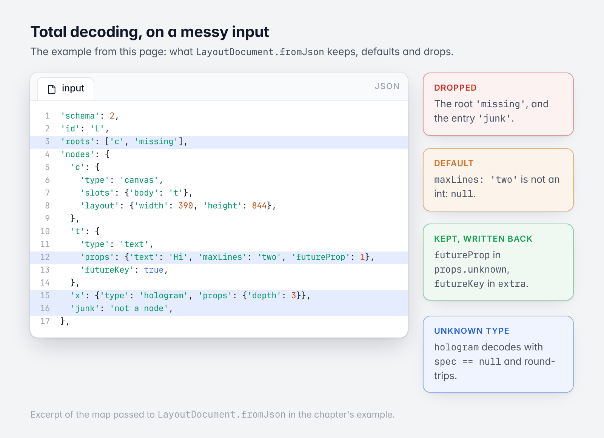
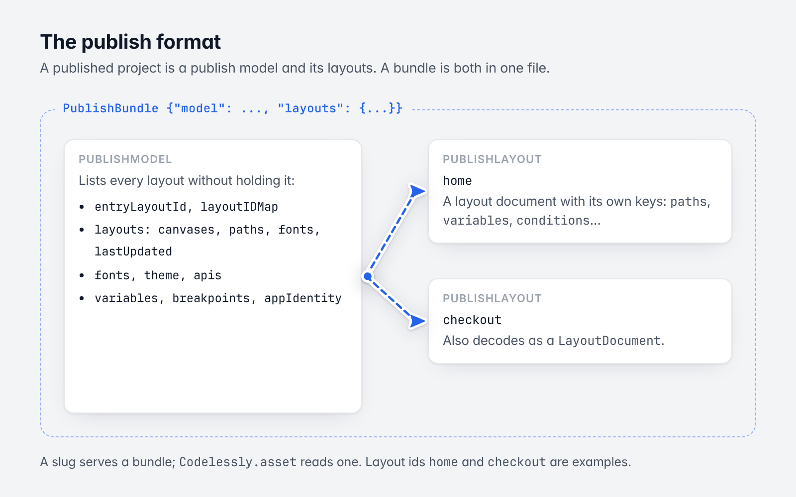

# 3. The JSON format

[Guide](README.md) · Previous: [Widgets and `WidgetSpec`](02-widgets-and-widgetspec.md) · Next: [Building and checking a layout in code](04-building-layouts-in-code.md)



*The three rules of the format.*

## Three rules

### Versioned

Every document carries `"schema": 2` (`kSchemaVersion`). Decoders upgrade any older v2 schema on load
(`LayoutDocument.migrateSchema`, `schemaMigrations`), so the format can evolve without breaking stored data.

Schema 1 is the format of `codelessly_api` 10.x and older. It is **not** read by this version. Every project
stored by Codelessly has already been converted.

### Total decoding



*The example below, annotated.*

`fromJson` never throws, for any input:

- an unknown key is kept in `extra` and written back;
- an unknown node type decodes as a `Node` whose `spec` is null, keeps its props raw, and round-trips;
- an unknown prop is kept in `Props.unknown`;
- a bad value falls back to the default;
- an entry that isn't a node is dropped; a root that names no node is dropped.

```dart
final document = LayoutDocument.fromJson({
  'schema': 2,
  'id': 'L',
  'roots': ['c', 'missing'],
  'nodes': {
    'c': {
      'type': 'canvas',
      'slots': {'body': 't'},
      'layout': {'width': 390, 'height': 844},
    },
    't': {
      'type': 'text',
      'props': {'text': 'Hi', 'maxLines': 'two', 'futureProp': 1},
      'futureKey': true,
    },
    'x': {'type': 'hologram', 'props': {'depth': 3}},
    'junk': 'not a node',
  },
});

// A root that names no node is dropped; an entry that isn't a node too.
assert(document.roots.length == 1 && document.nodes.length == 3);

// A bad value falls back to the default.
assert(document['t']!.prop(TextProps.maxLines) == null);

// Unknown props and keys are kept, and written back.
assert(document['t']!.props.unknown['futureProp'] == 1);
assert(document['t']!.extra['futureKey'] == true);

// An unknown type decodes (spec is null) and round-trips.
assert(document['x']!.spec == null);
```

This is what lets an older app show a layout made by a newer Editor: what it doesn't know, it keeps and skips.
The price is that decoding doesn't tell you a document is wrong; checking is a separate step
([chapter 4](04-building-layouts-in-code.md#checking-a-document)).

### Sparse encoding

`toJson` omits every value equal to its default. JSON stays small and diffs stay readable. Doubles are rounded
to 4 decimals, and integral ones are written as integers.

## A layout document

```json
{
  "schema": 2,
  "id": "layout-id",
  "roots": ["canvas-a"],
  "nodes": {
    "canvas-a": {"type": "canvas", "name": "Home", "slots": {"body": "col"},
                 "layout": {"width": 1440, "height": 900}},
    "col": {"type": "column", "children": ["title"],
            "layout": {"width": {"fill": 1440}, "height": {"hug": 626}, "padding": [24, 24, 24, 24]},
            "props": {"crossAxisAlignment": "start", "spacing": 12},
            "decoration": {"fills": [{"color": "#FFFFFFFF"}], "radius": 8}},
    "title": {"type": "text", "props": {"text": "Hello",
              "style": {"fontSize": 24, "fontWeight": 700, "color": "#FF111111"}}}
  },
  "variables":  {"canvas-a": [{"name": "count", "type": "integer", "value": 0}]},
  "conditions": {"canvas-a": []},
  "scripts": []
}
```

| Key | |
|---|---|
| `schema` | `2` |
| `id` | The layout's id |
| `roots` | Canvas ids, in order |
| `nodes` | `{id: node}`. A node's `id` is its key. |
| `variables`, `conditions` | Per canvas ([Logic](05-logic.md)) |
| `scripts` | The layout's scripts |
| `breakpoints` | The project's breakpoints, carried by an Editor page's document |
| anything else | Kept in `extra` |

A node's keys are the fields in [The data model](01-data-model.md#node), plus its behaviours stored flat
(`motion`, `scale`, `loops`, `transitions`, `inkWell`, `states`, `tooltip`, `hero`, `draggable`, `dropTarget`,
`drag`, `flip`, `tilt`...).

## The publish format



*A publish model, its layouts, and the bundle that holds both.*

A published project is a **publish model** and its **layouts**.

### `PublishModel`

```json
{
  "schema": 2,
  "projectId": "p",
  "slug": "my-project",
  "entryLayoutId": "home",
  "layoutIDMap": {"start": "home"},
  "layouts": {
    "home": {"canvases": [{"id": "home-m", "name": "Home · M"},
                          {"id": "home-d", "name": "Home · D", "path": "home"}],
             "fonts": ["f1"], "lastUpdated": 1790000000000}
  },
  "disabledLayouts": [],
  "fonts": {"f1": {"family": "Inter", "weight": 400}},
  "theme": {"primary": "#FF4B6CE5"},
  "apis": {},
  "variables": {},
  "breakpoints": [],
  "appIdentity": {}
}
```

It lists every layout without holding it: enough to route to a screen (`canvases`, each with its optional URL
`path`), know its fonts, and tell whether a cached copy is stale (`lastUpdated`). `layoutIDMap` maps custom,
developer-friendly ids to layout ids.

### `PublishLayout`

A layout document with its own keys beside the document's: `pageId`, `projectId`, `breakpoints` (which canvas is
the design for which project breakpoint), `paths` (canvas id → URL path pattern), `variables`, `conditions`,
`fonts`, `apis`, `theme`, `lastUpdated`. Because the document keys are at the top level, a published layout also
decodes as a `LayoutDocument`.

### `PublishBundle`

`{"model": {...}, "layouts": {"<layoutId>": {...}}}`: a whole publish in one file. It is what a project's slug
serves, what the SDK's `Codelessly.asset` reads, and the simplest way to hand a project to the SDK.

```dart
final bundle = PublishBundle.fromJson(json);
final model = bundle.model;

// A layout is named by its id, a custom id, or one of its canvases' ids.
assert(model.resolveLayoutId('home') == 'home');
assert(model.resolveLayoutId('start') == 'home');
assert(model.resolveLayoutId('home-d') == 'home');
assert(model.resolveLayoutId('nope') == null);

// The canvas for a width, by the project's breakpoints.
final layout = bundle.layouts['home']!;
assert(layout.canvasForWidth(400, model.breakpoints) == 'home-m');
assert(layout.canvasForWidth(1280, model.breakpoints) == 'home-d');
```

### Where a publish is stored

`PublishSource` names the three copies of a project and their paths:

```dart
assert(PublishSource.publish.modelPath('p') == 'publish/p');
assert(PublishSource.publish.layoutPath('p', 'home') == 'publish/p/layouts/home');
assert(PublishSource.preview.modelPath('p') == 'publish_preview/p');
assert(PublishSource.publish.bundlePath('my-slug') == 'publish/my-slug.json');
```

| Source | Collection | |
|---|---|---|
| `publish` | `publish` | What the project published |
| `preview` | `publish_preview` | The Editor's preview of unpublished changes |
| `template` | `templates` | The template gallery |

In Codelessly's backend the model and layouts are Firestore documents at those paths, and a slug's bundle is a
storage file. A layout too large for one Firestore document stores its nodes gzipped and base64-encoded under
`compressedNodes`; the SDK's loader expands it. Timestamps are milliseconds since the epoch.

## Is there a JSON Schema?

Not for version 20. The `schema/` directory at the repository root holds JSON Schema files for the 10.x format.
For 20.x the declarations themselves are the machine-readable schema: `Widgets.all` and each `PropDef.type`
([chapter 2](02-widgets-and-widgetspec.md#prop-types-for-tools)) describe every widget's props, types, defaults
and enum values, and a JSON Schema could be generated from them. [`DESIGN.md`](../../DESIGN.md) is the
prose specification.

Next: [Building and checking a layout in code](04-building-layouts-in-code.md)
