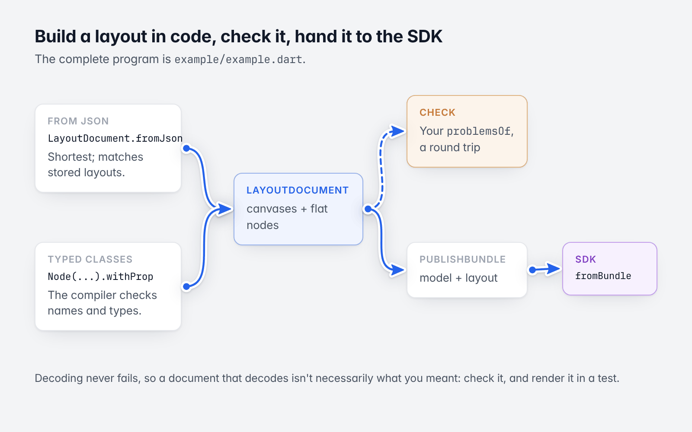
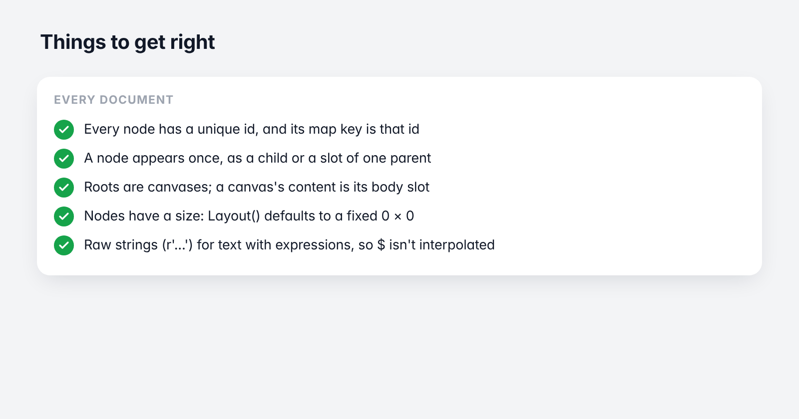
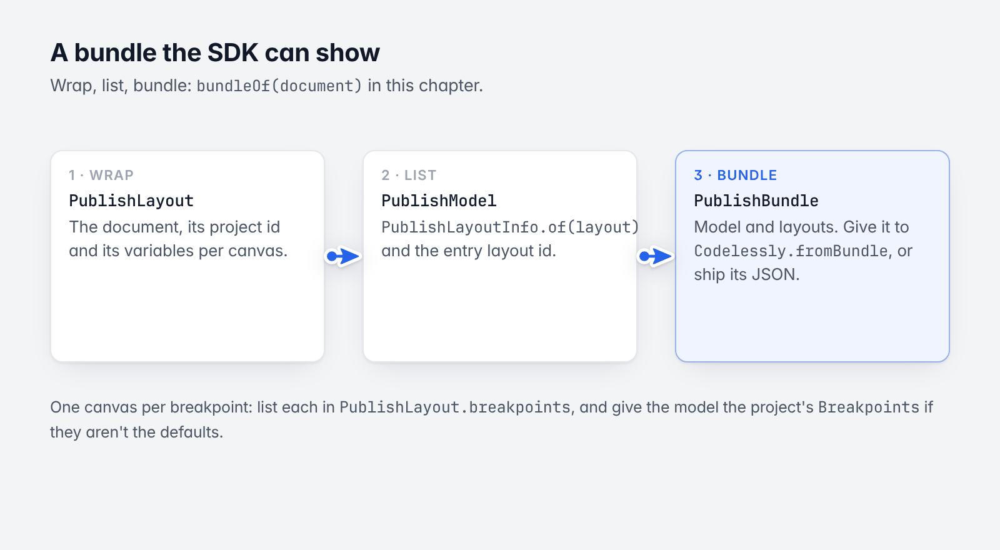

# 4. Building and checking a layout in code

[Guide](README.md) · Previous: [The JSON format](03-json-format.md) · Next: [Logic](05-logic.md)

The complete program for this chapter is [`example/example.dart`](../../example/example.dart):

```sh
dart run example/example.dart
```



*Build, check, bundle, show.*

## Two ways to build

**From JSON.** Write the document as a map and decode it. This is the shortest form and matches what you see in
stored layouts.

```dart
final document = LayoutDocument.fromJson({
  'schema': 2,
  'id': 'hello',
  'roots': ['home'],
  'nodes': {
    'home': {'type': 'canvas', 'slots': {'body': 'title'}, 'layout': {'width': 390, 'height': 844}},
    'title': {'type': 'text', 'props': {'text': 'Hello!'}},
  },
});
```

**With the typed classes.** The compiler checks names and types.

```dart
final title = const Node(
  id: 'title',
  type: 'text',
  name: 'Title',
  layout: Layout(width: AxisSize.hug(120), height: AxisSize.hug(28)),
  // A bound property: an expression the SDK evaluates while the app runs.
  bind: {'props.text': r'Hello, ${data.name}!'},
).withProp(TextProps.text, 'Hello!').withProp(
      TextProps.style,
      const TextStyle(fontSize: 24, fontWeight: 700, color: Color(0xFF111111)),
    );

final button = const Node(
  id: 'button',
  type: 'filledButton',
  layout: Layout(width: AxisSize.hug(120), height: AxisSize.fixed(44)),
  // A reaction: a trigger and the chain of actions it runs.
  actions: [
    Reaction(
      id: 'r1',
      trigger: Trigger(TriggerType.click),
      actions: [
        SetVariableAction(variable: 'count', write: ValueWrite(op: WriteOp.add, value: '1')),
        CallFunctionAction(name: 'onTap', params: {'count': r'${count}'}),
      ],
    ),
  ],
).withProp(ButtonProps.label, 'Tap me');

final column = const Node(
  id: 'column',
  type: 'column',
  children: ['title', 'button'],
  layout: Layout(
    width: AxisSize.fill(390),
    height: AxisSize.fill(844),
    padding: EdgeInsets.all(24),
  ),
)
    // A prop is checked against its declaration: 12 is stored as 12.0.
    .withProp(FlexProps.spacing, 12)
    .withProp(FlexProps.crossAxisAlignment, CrossAxisAlignment.start);

// A canvas is a screen. Its content is its `body` slot.
const canvas = Node(
  id: 'home',
  type: 'canvas',
  name: 'Home',
  slots: {'body': 'column'},
  layout: Layout(width: AxisSize.fixed(390), height: AxisSize.fixed(844)),
  decoration: Decoration(fills: [Paint.solid(Color.white)]),
);

// A document: canvases (roots) and every node in one flat map.
final document = LayoutDocument(
  id: 'hello',
  roots: const ['home'],
  nodes: {for (final n in [canvas, column, title, button]) n.id: n},
);
```



*The list below, at a glance.*

Things to get right:

- **Every node needs a unique `id`**, and the map key must be that id.
- **A node appears once** as a child or a slot of one parent.
- **Roots are canvases.** A canvas's content goes in its `body` slot.
- **Give nodes a size.** `Layout()` defaults to a fixed size of 0 × 0. Use `AxisSize.hug` for text and buttons,
  `AxisSize.fill` to stretch.
- **Text in props can hold expressions** (`'Taps: ${count}'`). Use raw strings (`r'...'`) in Dart so `$` isn't
  interpolated.

## Editing

Nodes and documents are immutable. An edit is a copy; unchanged nodes are shared.

```dart
final edited = document.copyWith(nodes: {
  ...document.nodes,
  't': document['t']!.withProp(TextProps.text, 'Hello').copyWith(opacity: 0.5),
});

// Value equality tells what changed.
final changed = [
  for (final id in edited.nodes.keys)
    if (edited[id] != document[id]) id,
];
```

A JSON merge patch applies several changes at once (this is how an interaction state changes a node):

```dart
final patched = node.patched({
  'props': {'text': 'Patched'},
  'visible': false,
});
```

To add a node, add it to `nodes` and to its parent's `children` (or `slots`). To remove one, remove it and its
descendants (`document.subtree(id)`) from `nodes`, and its id from its parent.

## Checking a document

Decoding never fails ([total decoding](03-json-format.md#total-decoding)), so a document that decodes isn't
necessarily what you meant. The package has no single `validate()` for documents. What it gives you to build
one:

| Check | How |
|---|---|
| A node's type is declared | `node.spec != null` |
| A prop is declared for the type | `node.props.unknown` is empty |
| Children exist | every id in `node.childIds` is in `document.nodes` |
| Roots are canvases | `document[root]?.type == 'canvas'` |
| A value survived decoding | Compare `toJson()` with the input: a dropped or defaulted value is missing from the output |
| A prop value is valid | `PropDef.coerce(value)` throws an `ArgumentError` for a value the codec can't read |
| A script's name, params and limits | `ScriptDef.validate()` returns the problems |

```dart
/// What's wrong with [document]: node types this version doesn't declare,
/// and children, slots and roots that name no node.
List<String> problemsOf(LayoutDocument document) => [
      for (final root in document.roots)
        if (document[root]?.type != CanvasProps.spec.type) 'root $root is not a canvas',
      for (final node in document.nodes.values) ...[
        if (node.spec == null) '${node.id}: unknown type "${node.type}"',
        for (final child in node.childIds)
          if (document[child] == null) '${node.id}: child $child does not exist',
      ],
    ];
```

A round-trip test catches most mistakes in hand-written JSON:

```dart
final document = LayoutDocument.fromJson(json);
expect(jsonDecode(jsonEncode(document.toJson())), jsonDecode(jsonEncode(json)));
```

(Write the input sparsely, without defaults, or the output will differ by the defaults it omits.)

The real test of a layout is rendering it: the SDK's test tools show a bundle in a widget test without a network
([SDK guide: Testing](https://github.com/Codelessly/CodelesslySDK/blob/master/docs/guide/14-testing.md)).

## A bundle the SDK can show



*Wrap, list, bundle.*

Wrap the document as a `PublishLayout`, list it in a `PublishModel`, and put both in a `PublishBundle`:

```dart
/// [document] published as a project of one layout.
PublishBundle bundleOf(LayoutDocument document, {String projectId = 'example'}) {
  final layout = PublishLayout(
    document: document,
    projectId: projectId,
    variables: {
      for (final canvas in document.roots)
        canvas: [const Variable(id: 'v_count', name: 'count', type: VariableType.integer, value: 0).toJson()],
    },
  );
  return PublishBundle(
    model: PublishModel(
      projectId: projectId,
      entryLayoutId: layout.id,
      layouts: {layout.id: PublishLayoutInfo.of(layout)},
    ),
    layouts: {layout.id: layout},
  );
}
```

`PublishLayoutInfo.of(layout)` builds the model's entry for a layout (its canvases, fonts and APIs).

Then, in a Flutter app with `codelessly_sdk`:

```dart
final codelessly = Codelessly.fromBundle(bundle);
runApp(MaterialApp(home: CodelesslyWidget(codelessly: codelessly)));
```

or write `jsonEncode(bundle.toJson())` to a file and ship it as an asset (`Codelessly.asset`).

For a layout with one canvas per breakpoint, list each canvas in `PublishLayout.breakpoints`
(`CanvasBreakpoint(canvasId: ..., breakpointId: 'mobile')`), and give the model the project's `Breakpoints` if
they aren't the defaults (mobile from 0, tablet from 600, desktop from 1024).

Next: [Logic](05-logic.md)
