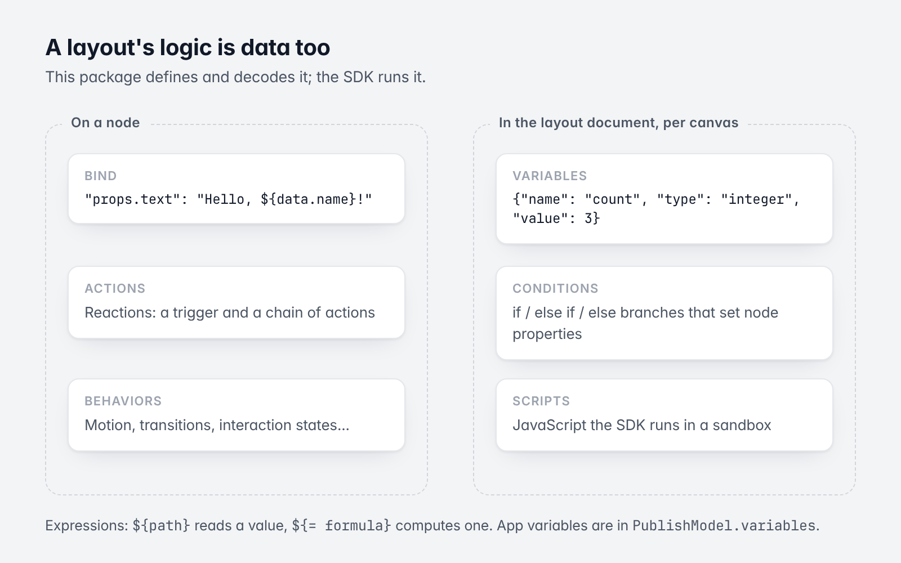
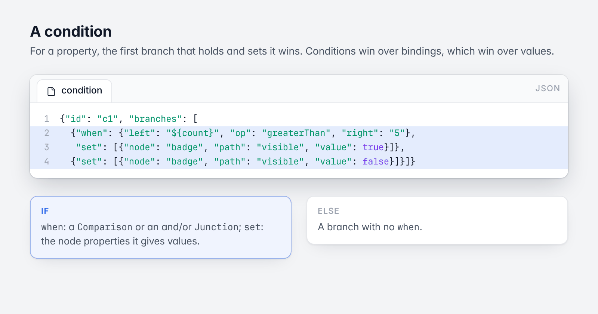
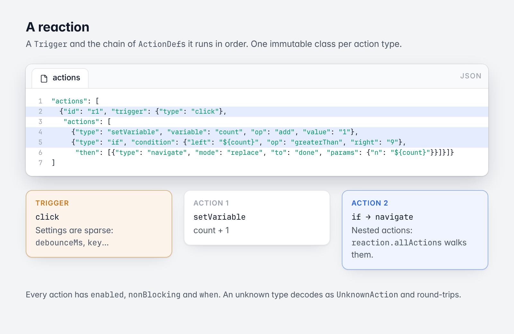

# 5. Logic: variables, conditions, bindings, actions, scripts

[Guide](README.md) · Previous: [Building and checking a layout in code](04-building-layouts-in-code.md)

A layout's logic is data too. This package defines and decodes it; the SDK runs it. This chapter is the shape of
that data. For how it behaves in an app, see the
[SDK guide](https://github.com/Codelessly/CodelesslySDK/tree/master/docs/guide).



*Where logic lives.*

## Expressions

Text fields throughout the model can hold expressions, evaluated by the SDK:

- `${path}` reads a value: `${user.name}`, `${cart[0].qty}`, `${title.length}`.
- `${= formula}` computes one: `${= price * qty}`.

A field that is exactly one expression keeps the value's type; any other text containing `${...}` is text.

## Variables

`Variable`: a `name`, a `VariableType` and a default `value`, or a `formula` that computes it.

```json
{"id": "var1", "name": "count", "type": "integer", "value": 3}
{"id": "var2", "name": "total", "type": "decimal", "formula": "price * qty"}
{"id": "v3", "name": "clamp01", "formula": "min(1, max(0, v))", "parameters": ["v"]}
{"id": "v4", "name": "draft", "value": "", "persist": true}
```

| Field | |
|---|---|
| `type` | `integer`, `text`, `decimal`, `boolean`, `color`, `list`, `map`, `image`, `choice` |
| `value` | The default, as the type holds it (JSON-native) |
| `formula` | What goes inside `${= ...}`. A computed variable is read-only. |
| `parameters` | A computed variable with parameters is a function formulas call by name |
| `options` | A choice variable's options |
| `persist` | The app keeps the value on the device |

## Conditions



*A condition, annotated.*

`Condition`: an ordered list of branches, `if` / `else if` / `else`. A branch has a `when` (a `Predicate`: a
`Comparison` `{left, op, right}`, or a `Junction` `{"and" | "or": [...]}`; none for `else`) and `set`, the node
properties it gives values.

```json
{"id": "c1", "branches": [
  {"when": {"left": "${count}", "op": "greaterThan", "right": "5"},
   "set": [{"node": "badge", "path": "visible", "value": true}]},
  {"set": [{"node": "badge", "path": "visible", "value": false}]}]}
```

For a property, the first branch that holds and sets it wins. Conditions win over the node's own binding, which
wins over the node's value.

## Where variables and conditions live

Per screen (canvas), in the layout document next to the nodes, under `variables` and `conditions`. Read them
typed through `LayoutLogic`:

```dart
final logic = document.logic;
final count = logic.variablesOf('home').first;
assert(count.name == 'count' && count.type == VariableType.integer && count.value == 0);
assert(logic.conditionsOf('home').single.branches.length == 2);

final updated = document.withLogic(logic);
```

A `PublishLayout` has the same (`layout.logic`, `layout.variablesOf(canvasId)`). Variables shared by every screen
of an app are in `PublishModel.variables`.

## Bindings

`Node.bind` maps a **binding path** to an expression. A path points into the node's JSON:

| Path | Value |
|---|---|
| `visible` | bool; false collapses the node |
| `opacity` | 0 to 1 |
| `layout.width`, `layout.height`, `layout.flex`, `layout.rotation`, `layout.margin`, `layout.padding`, `layout.x`, `layout.y` | Layout fields |
| `decoration.fills[0]`, `decoration.fills.<paintId>`, `...color`, `...image.url`, `...stops[i].color` | Paints |
| `decoration.strokeWidth`, `decoration.radius`, `decoration.effects.*.color`... | Decoration |
| `props.<prop>`, `props.<prop>.<field>` | A widget prop, by its declaration's codec |
| `props.style.<field>` (text) | The base text style and every run's |
| `data` | The items a list, grid or page view builds one child per |
| `motion.<field>`, `scale`, `hero.tag`, `track.*`, `dismissible.*`, `pan.*`... | Behaviors |

`[i]` is a list index, a paint or effect id selects that item, and `*` every item. `BindPaths` (in
`bindings.dart`) has the constants and helpers. Values are read loosely (`"12"` is a number, `"#F00F00"` a
color); a value that can't be read leaves the property as it was.

## Reactions and actions



*A reaction: a trigger and its chain.*

`Node.actions` is a list of `Reaction`s: a `Trigger` and the chain of `ActionDef`s it runs in order.

```json
"actions": [
  {"id": "r1", "trigger": {"type": "click"},
   "actions": [
     {"type": "setVariable", "variable": "count", "op": "add", "value": "1"},
     {"type": "if", "condition": {"left": "${count}", "op": "greaterThan", "right": "9"},
      "then": [{"type": "navigate", "mode": "replace", "to": "done", "params": {"n": "${count}"}}]}]}
]
```

**Triggers** (`TriggerType`): `click`, `doubleTap`, `longPress`, `hold`, `secondaryClick`, `pointerDown`,
`pointerUp`, `hover`, `cursorEnter`, `cursorExit`, `swipeLeft`, `swipeRight`, `swipeUp`, `swipeDown`, `drag`,
`dragEnd`, `wheel`, `pinch`, `changed`, `changeEnd`, `submitted`, `editingComplete`, `focusGained`, `focusLost`,
`load`, `backPressed`, `valueChanged`, `timer`, `clock`, `keyDown`, `keyUp`, `scroll`, `scrollEnd`,
`enterViewport`, `exitViewport`, `dragStart`, `dragCancel`, `dragCompleted`, `drop`, `dragEnter`, `dragExit`,
`dragHover`, `dropRejected`, `dropFull`, `reorder`, `refresh`, `swipeAction`. A trigger's settings are sparse:
`debounceMs`, `variable`, `intervalMs`, `key`, `when`, `holdMs`...

**Actions** (`ActionDef`, sealed, one immutable class per `type`):

| `type` | Class |
|---|---|
| `navigate`, `openModal`, `closeModal`, `openLink` | `NavigateAction`, `OpenModalAction`, `CloseModalAction`, `OpenLinkAction` |
| `setVariable`, `animateVariable`, `setValue`, `setVariant`, `setStorage` | State |
| `if`, `forEach`, `delay`, `confirm` | Flow |
| `callFunction`, `runScript` | The app's code and scripts |
| `callApi`, `loadCloudData`, `reloadCloudData`, `cloudData`, `cloudDocuments`, `cloudBatch`, `cloudFiles`, `paginate` | Data |
| `callFunction`, `runScript`, `emitEvent` | The app's code, scripts and app events |
| `callApi`, `loadCloudData`, `cloudData`, `cloudDocuments`, `cloudBatch`, `cloudFiles`, `paginate` | Data |
| `auth`, `paywall` | Accounts and purchases |
| `showToast`, `haptic`, `playSound`, `speak`, `copyToClipboard` | Feedback |
| `submitForm`, `editText`, `focus`, `scrollTo`, `playAnimation`, `controlTrack`, `controlDismissible`, `controlTransform` | Inputs and motion |
| `captureScreenshot` | Capture (`${result.image}`, a PNG `data:` URL) |

Every action has `enabled`, `nonBlocking` (not awaited) and `when` (a predicate). An unknown `type` decodes as
`UnknownAction` and round-trips. `ActionDef.fromJson(json)` decodes one (null for JSON that isn't an action);
`action.toJson()` encodes it;
`reaction.allActions` walks nested ones.

### Cloud data bound to a layout

`loadCloudData` keeps a document, a query's documents or a number in a variable, live:

```json
{"type": "loadCloudData", "variable": "cards", "single": false, "limit": "${shown}",
 "query": {"enabled": true, "collectionPath": "cards",
           "joins": [{"collection": "card_state", "as": "state", "id": "${auth.uid}_${item.id}"}]}}
{"type": "loadCloudData", "variable": "unread", "single": false, "aggregate": "count",
 "query": {"enabled": true, "collectionPath": "cards",
           "whereFilters": [{"field": "read", "operator": "equal", "value": "false"}]}}
```

- `limit`: a number or expression over `query.limit`; empty: the query's, else `kDefaultCloudLoadLimit` (500);
  `0`: every document. The variable's `hasMore` says whether more match.
- `aggregate` (`count`, `sum`, `average`, with `aggregateField`): a number computed by the database, without the
  documents; `refreshSeconds` also re-runs it on a timer.
- `query.joins` (`CloudJoin`): per item, the matching document of another collection under `as`, matched by a key
  template `id` (the match's document id, `${item.*}` reading the item) or `localField` = `foreignField`; `many`
  keeps every match.
- `reactive` (default true): the load runs again when a value its query reads changes. `reloadCloudData {variable}`
  subscribes it afresh. One variable has one live load.
- `cloudBatch.forEach`: its `cloudData` write steps per item (`${loop.item}`), committed together (500 writes per
  commit, `kMaxCloudBatchWrites`; `transaction` refuses more).
- `Trigger.onceKey` runs a reaction once per key per app session; `Trigger.visibleMs` makes `enterViewport` wait for
  the node to stay in view. `ListViewProps.pullToRefresh` lets a list without pagination fire its `refresh`
  reactions.
### Presenting, app events, host calls and capture

- `openModal` presentations: `dialog`, `bottomSheet`, `adaptive`, `sideSheet`, `fullScreen`, `popover` and
  `banner` (along the top edge, or the bottom one when `alignment`'s y is above 0; no barrier, so the app stays
  usable; a swipe dismisses it when `barrierDismissible`). A runtime that doesn't know `banner` shows a dialog.
- `emitEvent` (`event`, `props`) fires an app event: automations listening for it run, and the host hears it.
- `callFunction` calls a function the host app registered and branches on what it answered (`${result}`); with
  `optional: true` a function the host didn't register gives `null` instead of failing the chain.
- `captureScreenshot` (`target`: `layout`, `node` with `node`, or `app`; `pixelRatio`) gives
  `{"image": "data:image/png;base64,...", "width", "height"}`. Bind `image` to an image fill, or upload it with
  `cloudFiles` and `"source": "${shot}"` (a `data:` URL, a `{"data", "name"}` map or a list), which uploads
  that value instead of asking the user to pick files.

### Automations

A publish model's `automations` (`Automation`, read with `model.automations`, kept in `extra` so a model
without them is unchanged): what the project does on its own at app-level moments, with no node.

```json
"automations": [
  {"id": "rate-us", "trigger": "event", "event": "order_completed",
   "when": "usage.events.order_completed.count >= 3 && auth.isSignedIn",
   "maxRuns": 1, "delayMs": 1500, "priority": 1,
   "actions": [{"type": "openModal", "to": "rate-us"}]}
]
```

| Field | Meaning |
|---|---|
| `trigger` | `appStart`, `sessionStart` (start, or a return after a while in the background: the runtime's session timeout), `resume`, `event` (`event`), `interval` (`intervalMs`), `screenShown` (`screen`; empty: any) |
| `when` | A formula over `event` (`name`, `props`), `usage`, the app's variables, `auth`, `storage`, `data`; empty: always |
| `maxRuns`, `maxPerSession`, `everyDays` | How often: once (`maxRuns: 1`), once per session, at most every n days; 0: no limit |
| `delayMs`, `priority` | Wait after the trigger (then `when` is checked again); which presentation shows first when several wait |
| `actions` | The chain it runs (`${result}` starts as the event's props) |

`usage` is what the runtime counts per user on the device: `launches`, `sessions`, `firstSeen`, `lastSeen`,
`isFirstLaunch`, `isFirstSession`, `events.<name>.count` / `.last`, and `automations.<id>.count` / `.last` /
`.session`. `AutomationFields` declares the fields for generated editors.

## Scripts

`ScriptDef`: JavaScript a layout runs in the SDK's sandbox. Stored in the document's `scripts` list.

```json
{"id": "s1", "name": "loanPayment", "params": [{"name": "principal"}, {"name": "rate", "defaultValue": 5}],
 "source": "return principal * rate / 100;", "capabilities": ["variables.read"]}
```

```dart
const script = ScriptDef(
  id: 's1',
  name: 'loanPayment',
  params: [ScriptParam(name: 'principal'), ScriptParam(name: 'rate', defaultValue: 5)],
  source: 'return principal * rate / 100;',
);
assert(script.validate().isEmpty);
```

`validate()` checks the name and params (JavaScript identifiers, not reserved names such as `vars` or `app`) and
the limits (`timeoutMs` 1 to 30000, `memoryLimitMb` 1 to 256). It doesn't check the source; the engine does.
`ScriptCapability` lists what a script may be granted. `document.scripts` and `document.script(idOrName)` read a
document's scripts; a page script wins over a project script of the same name.

## Services configuration

Published with the model: `HttpApi` (an API's method, URL, headers, query, body and inputs), `PaywallConfig`,
and, read live by the SDK rather than published, `DataRules` (who may read and write each cloud collection).
`ServiceConfig` groups the APIs and paywall setup.

`DataRules` (the document `data_rules/{projectId}`): `collections` maps each top-level collection to a `DataRule`:

| Rule | Reads | Writes |
|---|---|---|
| `app` (default) | anyone using the app | anyone using the app |
| `signedIn` | signed-in users | signed-in users |
| `owner` | the owner (`ownerId`) | the owner |
| `publicReadOwnerWrite` | anyone | the owner |
| `roleWrite` | anyone | users with the collection's role (`roles`, default `admin`) |
| `ownerRead` | the owner | the project's editors, the server and the collection's role; the owner changes only `ownerFields` |
| `audience` | users the `audience` list names (`*`, `signedIn`, `role:{role}`, `user:{uid}`) | as `ownerRead` |

The project's editors read and write every collection. `ownerFields: {collection: [field]}` are the fields an
`ownerRead` owner may change on an existing document (never `ownerId`, `audience` or the expiry field).
`expiry: {collection: field}` makes documents unreadable to app users past the time in that field (ISO-8601 UTC
text such as `2026-12-01T00:00:00.000Z`; `DataRules.neverExpires` for none); queries on the collection must filter
`field > now`, which the SDK adds, and documents a week past their expiry are deleted by a scheduled function.

```json
{
  "collections": {"notes": "ownerRead", "news": "audience"},
  "roles": {"news": "admin"},
  "ownerFields": {"notes": ["read", "readAt"]},
  "expiry": {"news": "expiresAt"}
}
```

## Breakpoints, theme, identity

- `Breakpoints` and `Breakpoint` (`id`, `name`, `minWidth`, design `width` and `height`): the project's size
  classes. `Breakpoints.defaults` is mobile (0), tablet (600), desktop (1024). `forWidth(width)` picks one.
- `ThemeTokens`: `primary`, `onPrimary`, `surface`, `onSurface`, `error`, `success`, `warning`, `fontFamily`,
  `titleFontFamily`, `radius`, `buttonRadius`; `colors` and `textStyles`, every named style by key
  (`ThemeTokens.themeKey`: "Brand Blue" is `brandBlue`); and `dark`, the colors that differ in dark mode
  (`forBrightness(dark: true)` puts them over the light ones). Layouts read them at run time as
  `${theme.primary}`, `${theme.colors.brandBlue}`, `${theme.text.title.fontSize}` and `${theme.isDark}`.
- `StyleSheet` holds a project's named text and color styles; a `NamedColorStyle` can have a `dark` paint beside
  its `paint` (`{"id": "c1", "name": "Surface", "paint": {"color": "#FFFFFFFF"}, "dark": {"color": "#FF121212"}}`).
  `StyleSheet.theme` builds the published `ThemeTokens` from them: roles by name, every style by key, the dark
  paints into `dark`.
- `AppIdentity`: the app's name, title template, description, theme color, per-page overrides, icons and social
  card.

