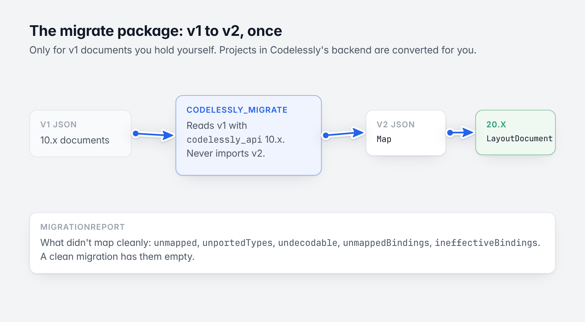
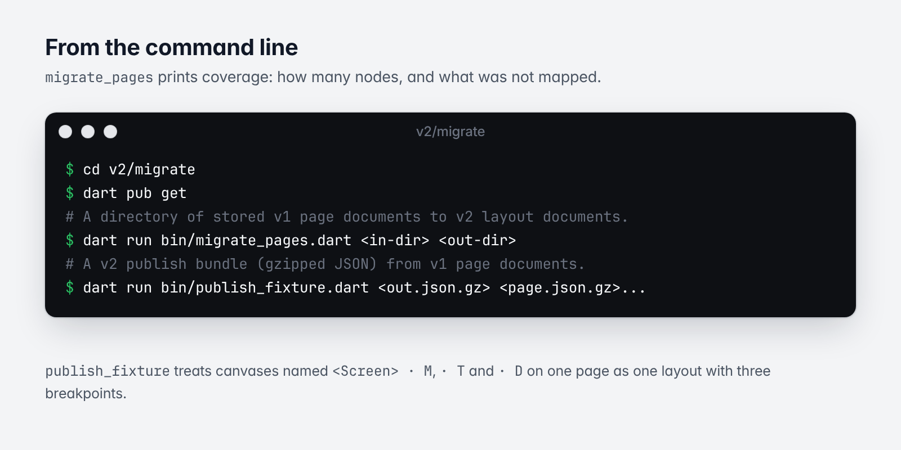
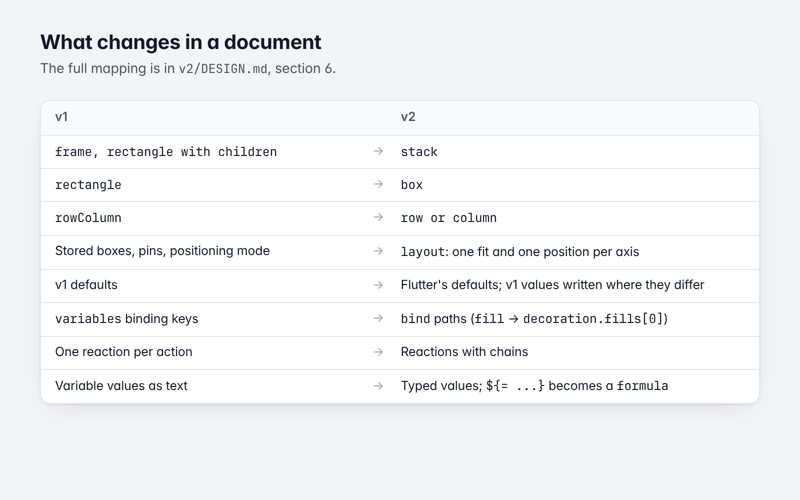

# 6. The migrate package (v1 to v2)

[Guide](README.md) · Previous: [Logic](05-logic.md)

`v2/migrate` (`codelessly_migrate`) converts documents in the 10.x format (v1) to the 20.x format (v2). It is a
separate, unpublished package (`publish_to: none`) in this repository.



*v1 to v2, once per document.*

You need it only if you hold v1 documents yourself: exported pages, fixtures, a self-hosted mirror. Projects in
Codelessly's backend are converted by Codelessly's own tooling, which uses this package; app developers don't run
it ([SDK guide: Migrating from 10.x](https://github.com/Codelessly/CodelesslySDK/blob/master/docs/guide/16-migrating-from-10.md)).

## How it is built

- It depends on **`codelessly_api` 10.x** (the repository root, by path) and reads v1 with v1's own decoders and
  box geometry.
- It **never imports v2**: both versions have the same package name, so they can't be imported together. Its
  output is plain v2 JSON (`Map<String, Object?>`), which v2 then decodes.
- It runs **once** per document. The v2 SDK never reads v1.

```
v1 JSON ──(codelessly_api 10.x decoders)──▶ migrate ──▶ v2 JSON ──(codelessly_api 20.x)──▶ LayoutDocument
```

## Using it

```sh
cd v2/migrate
dart pub get
```

### From the command line



*The two commands.*

```sh
# A directory of stored v1 page documents (*.json.gz, the Editor's page format) to v2 layout documents.
dart run bin/migrate_pages.dart <in-dir> <out-dir>

# A v2 publish bundle (gzipped JSON) from v1 page documents: what the SDK's tests and example use.
dart run bin/publish_fixture.dart <out.json.gz> <page.json.gz>...
```

`migrate_pages` prints coverage: how many nodes, and what was not mapped.

`publish_fixture` treats canvases named `<Screen> · M`, `· T` and `· D` on one page as one layout with mobile,
tablet and desktop breakpoints; every other canvas is a layout of its own, and the first layout is the entry
screen.

### From Dart

```dart
import 'package:codelessly_migrate/codelessly_migrate.dart';

final report = MigrationReport();
final Map<String, Object?> v2 = migrateDocument(
  v1Document,            // a stored v1 page document: id → node JSON, plus `rootNode`
  id: 'layout-id',
  report: report,
  variables: v1Variables,    // canvas id → (id → JSON), as v1 stored them
  conditions: v1Conditions,
);
```

| Function | Converts |
|---|---|
| `migrateDocument` | A v1 page document to a v2 layout document |
| `migratePublishModel`, `migratePublishLayout` | A v1 publish model and layout to v2 |
| `migrateComponent` | A stored v1 component to a v2 `ComponentDefinition` |
| `migrateStyleSheet` | A v1 style sheet |
| `migrateHttpApi`, `migrateServices`, `migratePaywall`, `migrateDataRules` | Services |
| `migrateProjectBreakpoints` | A project's breakpoints, from the switch points its v1 pages used |

`MigrationReport` says what didn't map cleanly: `unmapped` (v1 keys kept verbatim under `extra.v1`),
`unportedTypes` (node types with no v2 declaration, their props kept raw), `undecodable` (nodes v1 itself
couldn't decode), `unmappedBindings`, `ineffectiveBindings` (v1 bindings that did nothing, dropped). A clean
migration has them empty.

## What changes in a document



*The main mappings.*

| v1 | v2 |
|---|---|
| A class per node type (`BaseNode` subclasses) | `Node` with a `type` and typed props |
| `frame`, `rectangle` with children | `stack` |
| `rectangle` | `box` |
| `rowColumn` | `row` or `column` |
| Stored boxes (`basicBoxLocal`...), pins, positioning mode | `layout`: one size fit and one position per axis |
| Defaults of v1 (`mainAxisAlignment: center`...) | Flutter's defaults; v1's values are written explicitly where they differ |
| `variables` binding keys on a node | `bind` paths (`fill` → `decoration.fills[0]`, `textColor` → `props.style.color`) |
| One reaction per action | Reactions with chains; every v1 action type mapped (`navigation` → `navigate`, `showDialog` → `openModal`, `link` → `openLink`, `conditional` → `if`...) |
| Variable values stored as text | Typed values; a `${= ...}` value becomes a `formula` |
| Canvas variables and conditions in the publish model | In each layout, per canvas |
| Component markers | `component` links |

[`v2/DESIGN.md`](../../v2/DESIGN.md), section 6, has the full mapping.

## Parity

The conversion is tested against real pages: v1 fixtures are migrated, v2 must decode them, and the SDK's tests
render the migrated pages and compare every node's rectangle with what the v1 renderer drew, to within 1 px.

```sh
cd v2/migrate
dart test
```

Back to the [guide](README.md).
