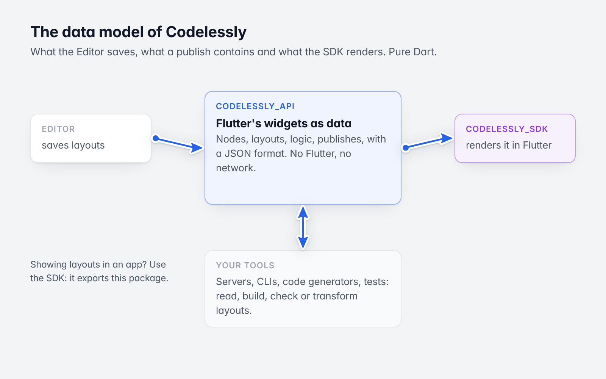

# codelessly_api guide

For `codelessly_api` 22.x. The samples here run as
[`example/example.dart`](../../example/example.dart) and
[`example/guide.dart`](../../example/guide.dart) (`dart run --enable-asserts example/guide.dart`).

`codelessly_api` is the data model of Codelessly: what the Editor saves, what a publish contains and what the SDK
renders. It is pure Dart. To show layouts in a Flutter app you want the
[SDK guide](https://github.com/Codelessly/CodelesslySDK/tree/master/docs/guide) instead; read this one to
understand, build, check or transform layouts as data.

*The model, between the Editor and the SDK.*

| # | Chapter | |
|---|---|---|
| 1 | [The data model](01-data-model.md) | Node, layout, decoration, props, document |
| 2 | [Widgets and `WidgetSpec`](02-widgets-and-widgetspec.md) | The widget declarations, prop types, introspection |
| 3 | [The JSON format](03-json-format.md) | Schema version, total decoding, sparse encoding, the publish format |
| 4 | [Building and checking a layout in code](04-building-layouts-in-code.md) | Typed construction, editing, validation, a bundle for the SDK |
| 5 | [Logic](05-logic.md) | Variables, conditions, bindings, reactions and actions, scripts |
| 6 | [Chart data transitions](06-chart-data-transitions.md) | Data matching, animation controls, interrupted updates and gaps |
| 7 | [Drawing with `customPaint`](07-custom-paint.md) | Flutter's `CustomPaint` and `Canvas` calls as data: ops, paints, expressions, hit regions |

For contributors, [`DESIGN.md`](../../DESIGN.md) is the full design of the format.
